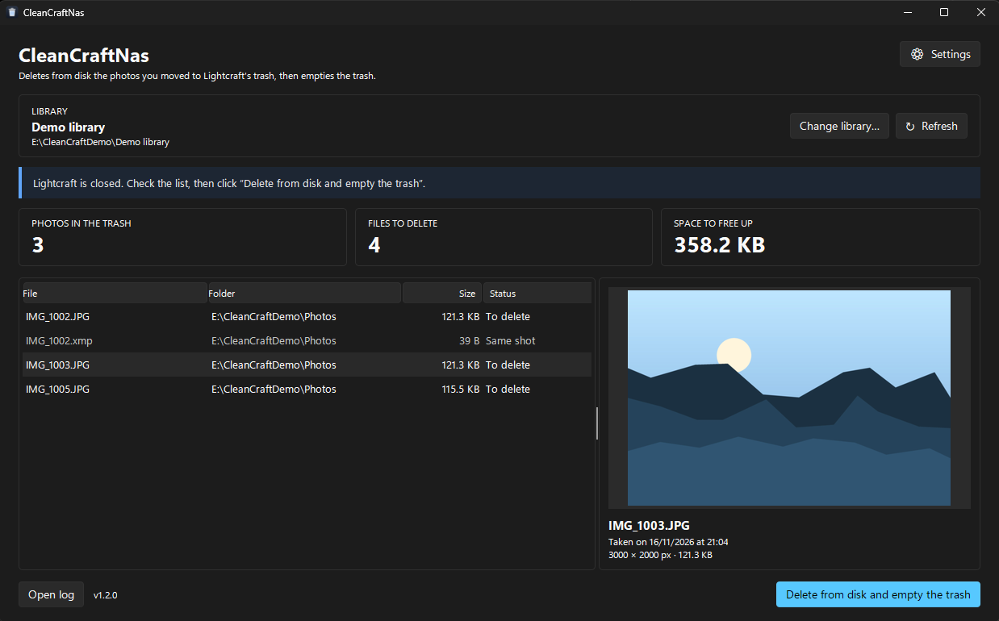
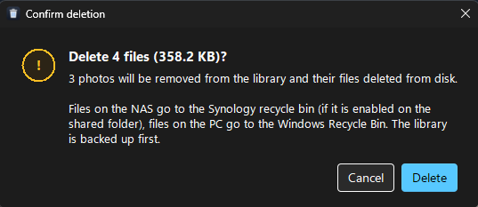
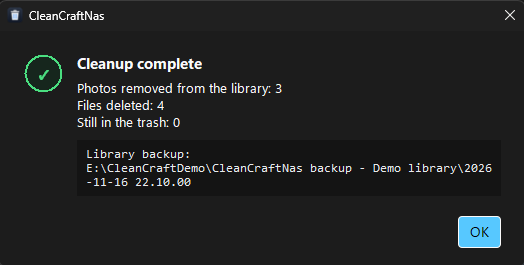
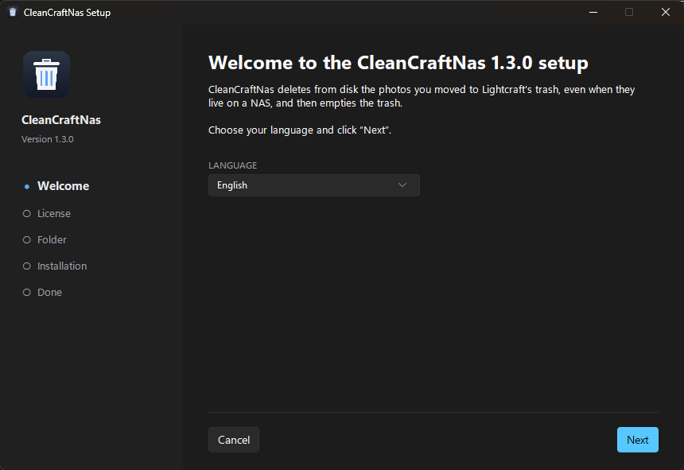
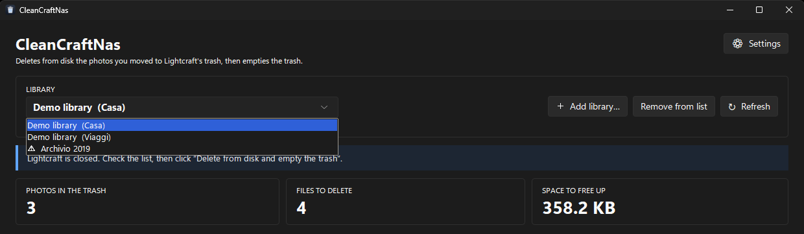
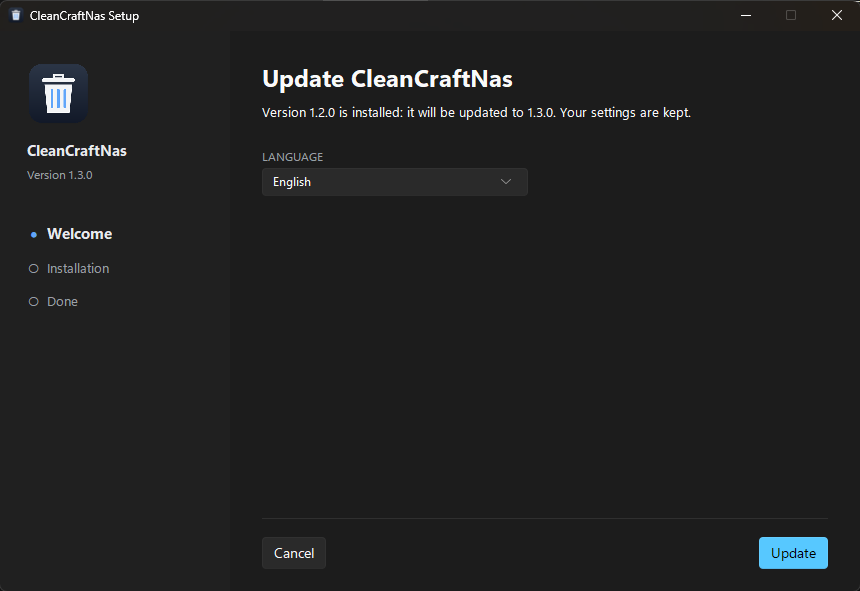
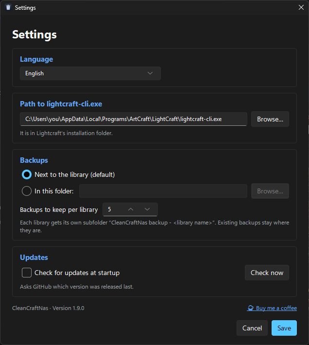

<p align="center"></p>

<h1 align="center">CleanCraftNas</h1>

<p align="center">
Delete from disk the photos you put in <b>LightCraft</b>'s trash — even when they live on a NAS — and keep the trash in sync.<br>
<a href="#-italiano">🇮🇹 Italiano</a> · <a href="https://github.com/poty87/CleanCraftNas/releases/latest">⬇ Download</a> · <a href="https://buymeacoffee.com/poty87">☕ Buy me a coffee</a> · <a href="https://paypal.me/poty87">PayPal</a>
</p>



> CleanCraftNas is an independent tool. It is not made by, affiliated with or endorsed by the authors of
> [LightCraft](https://github.com/storytold/lightcraft).

## Part of a suite

This app is one of three independent tools that, together, build a **workflow for [LightCraft](https://github.com/storytold/lightcraft)
with your photos on a NAS** — any NAS or server with an SMB shared folder (Synology, QNAP, TrueNAS, Unraid, a Windows
share…): bring the photos home, import them with the right colours, browse and edit your library from the phone, and keep
the NAS clean. Each one works on its own; together they cover the whole path.

| App | Runs on | What it does |
|---|---|---|
| [**PresetCraftAppLicator**](https://github.com/poty87/PresetCraftAppLicator) | Windows PC | Watches a NAS folder and imports new photos into LightCraft automatically; applies the ratings, flags, metadata and presets chosen on the phone; puts your libraries on the phone, with optional search by subject (AI). For Ricoh GR cameras it also gives each photo the camera profile of the style it was shot with. |
| [**ViewerCraftStar**](https://github.com/poty87/ViewerCraftStar) | Android | Browse, search and edit your whole LightCraft libraries on the phone. Optionally import new photos on the phone too (from a Ricoh GR camera or from an external disk), review them (flags, stars, labels, metadata, presets with preview) and send them to the NAS, following them until they are safe at home. |
| [**CleanCraftNas**](https://github.com/poty87/CleanCraftNas) | Windows PC | Deletes from disk — even on the NAS — the photos you put in LightCraft's trash, so the NAS stays in step with the library. |

**Which cameras.** The suite works with the photos of most cameras: whatever LightCraft opens (DNG, CR2/CR3, NEF, ARW,
ORF, RAF, JPEG…; PresetCraftAppLicator can also convert proprietary raws to DNG with the free Adobe DNG Converter). For now
only two things are specific to **Ricoh GR** cameras:
- giving each photo the camera profile of its picture style (PresetCraftAppLicator);
- downloading photos straight from the camera over Wi-Fi (ViewerCraftStar). The same import also works from an external
  disk or card reader plugged into the phone, with DNGs and JPEGs from any camera.

**Two ways to bring photos home**

- **The classic way, from the PC.** Copy the photos to the NAS as you always do (card reader, the camera's software, any
  sync tool): PresetCraftAppLicator imports them from the watched folder. You can still browse, search, rate and edit them
  from the phone, because the phone shows the whole library, not only what it sent.
- **From the phone — a plus, not a requirement.** Import from the camera or an external disk, review on the phone and
  *Send to the NAS*: the app moves the photos to a phone folder that your NAS's sync or backup app uploads (for example
  Synology Drive, QNAP Qfile, Nextcloud, Syncthing) and writes your choices next to them (`.xmp`).

Then edit in LightCraft; the photos you don't want go to LightCraft's trash, and **CleanCraftNas** deletes them from the
NAS too.

**Away from home** the phone reaches the NAS through a VPN to your home network (OpenVPN, built into ViewerCraftStar): see
the [remote access guide](https://github.com/poty87/ViewerCraftStar/blob/main/docs/remote-access.md). The guide uses Synology's *VPN Server* as an example, but any
OpenVPN server works (a router, another NAS brand, a PC).

## Why it exists

[LightCraft](https://github.com/storytold/lightcraft) can work with photos **in place**: when you add a folder (for example a
folder on a NAS mapped as `Y:`), the library only *references* the files and never moves them. CleanCraftNas works with
the photos of any camera and with any NAS or shared folder Windows can reach.

That is great until you want to get rid of a photo. In LightCraft (checked on version 0.21.1):

| Command | What happens to the library | What happens to the file on disk |
|---|---|---|
| **Delete Photo** (`Delete` key) | the photo goes to **Recently Deleted** (the trash) | stays |
| **Empty Recently Deleted** | the photos are removed from the library | **stay** |
| **Delete Permanently** | the photo is removed from the library | **stays** |

LightCraft only deletes files it owns (photos *copied* into the library's `Originals` folder). For photos that live on your
NAS there is no way to delete the file: you end up with a clean library and a NAS full of photos you threw away, and you
would have to find and delete each file by hand.

## How it works

CleanCraftNas uses **LightCraft's trash as the list of what to delete**:

1. In LightCraft, press `Delete` on the photos you don't want. They move to **Recently Deleted**.
2. Close LightCraft.
3. Open CleanCraftNas. It reads the library and lists every photo in the trash, with a **preview** (click a row; double-click
   to enlarge), the file, its folder and its size.
4. Click **Delete from disk and empty the trash** and confirm.



### Choose what happens to each photo

Every row has a soft colour that says what will happen to that photo; **right-click** one or more rows (Shift/Ctrl + click to
select several) to change it:

| Colour | Right-click menu | What happens |
|---|---|---|
| red (default) | **Delete from disk and trash** | the files are deleted and the photo leaves LightCraft's trash |
| yellow | **Remove from trash only** | the photo leaves the trash, the files stay where they are |
| green | **Leave in trash** | nothing: the photo stays in LightCraft's trash |

Yellow and green choices are remembered per library. Photos whose file is **already gone** from disk (for example videos you
moved elsewhere) are recognised automatically, removed from the trash only, and listed by name in the final summary. The same
menu has **Show in File Explorer**.

The list can be **sorted by any column** (click the heading, click again to reverse; the RAW/JPG/XMP of one shot stay together).
Besides file, folder, size and status there are **On disk** (✓/✗: is the file still there?), **Created**, **Modified**,
**Camera** and **Author**: choose which ones to show with **Columns** or by right-clicking the headings, and put them in the
order you like by **dragging a heading** left or right (or right-click it › *Move left* / *Move right*). The order is
remembered.

CleanCraftNas then:

1. **backs up the library** (`catalog.snap`, `catalog.log`, `view.json`) into a `CleanCraftNas backup - <library>` folder next
   to it, keeping the last 5;
2. **deletes the files of the photos in the trash**, together with the files of the same shot that sit next to them with the
   same name: the **JPG** of a RAW+JPG pair and the **XMP** sidecar;
3. **empties LightCraft's trash** by running LightCraft's own command (`lightcraft-cli photo.deletePermanently`) on exactly the
   photos whose files were deleted. The library files are never edited by hand.



### Safety

- It **refuses to run while LightCraft is open** (app or `lightcraft-cli`), and checks again right before deleting.
- A file is **never deleted if a photo still in the library uses it** (for example the original of a virtual copy you
  trashed).
- Deletions are recoverable for a while: files on a **NAS** go to the NAS's **recycle bin** of the shared folder, if it
  has one turned on (on Synology `#recycle`, on QNAP `@Recycle`), files on the **PC** go to the **Windows Recycle Bin**.
- If a file can't be deleted, its photo **stays in the trash** and the error is shown and logged.
- Every operation is written to a log (`%LOCALAPPDATA%\CleanCraftNas\cleancraftnas.log`, button **Open log**).

### Backups

Before every cleanup the library catalog is copied to a `CleanCraftNas backup - <library>` folder. By default it sits next to
the library; in **⚙ Settings** you can choose another folder on your PC and how many backups to keep per library (5 by
default). The **Backups…** button lists the backups of the current library (also those made in another folder or by older
versions) with date and size, opens their folder and deletes the ones you select, or all of them: they go to the Recycle
Bin.

## Install

Download **`CleanCraftNas-Setup-x.y.z.exe`** from [Releases](https://github.com/poty87/CleanCraftNas/releases/latest) and run it.



- The setup has the same look as the app and walks you through **language**, **license**, **folder** (default
  `%LOCALAPPDATA%\Programs\CleanCraftNas`) and an optional **Desktop shortcut**, with a real progress bar.
- **Everything is included** (Python, Tk, Pillow…): nothing else needs to be installed, and an existing Python on your PC is
  neither used nor touched.
- It installs **for your user only**, without administrator rights.
- Run it again to **reinstall** (repair) or **uninstall**; you can also uninstall from *Settings › Apps*. Your settings and log
  are kept.

On first start click **＋ Add library…** and pick the LightCraft library folder (the one containing `catalog.snap`).

### More than one library

Add as many libraries as you like with **＋ Add library…** and switch between them from the drop-down menu: the list, the
backups and the cleanup always refer to the library you picked, and CleanCraftNas reopens on the last one. Libraries with the
same folder name show the folder that contains them; a library that can't be found right now (drive not connected, folder
moved) is marked with ⚠. **Remove from list** only forgets a library: its photos and backups are not touched.



**Requirements:** Windows 10 or 11 (64-bit) and LightCraft installed (CleanCraftNas uses its `lightcraft-cli.exe`; if it is not
in the usual place, `%LOCALAPPDATA%\Programs\ArtCraft\LightCraft`, you can point to it in **Settings**).

<details>
<summary>Silent install and plain MSI (for scripts and IT)</summary>

```powershell
CleanCraftNas-Setup-x.y.z.exe --silent [--dir "D:\Apps\CleanCraftNas"] [--lang en] [--no-desktop]
CleanCraftNas-Setup-x.y.z.exe --silent --uninstall
```

The release also has the plain `CleanCraftNas-x.y.z.msi` (the setup contains the same package):

```powershell
msiexec /i CleanCraftNas-x.y.z.msi /qn CCN_LANGUAGE=en CCN_DESKTOP=0 TARGETDIR="D:\Apps\CleanCraftNas"
```

`CCN_LANGUAGE`: `auto`, `it`, `en`, `de`, `es`, `fr`, `pt`. `CCN_DESKTOP`: `1` (default) or `0`.
</details>

## Updates

- At every start CleanCraftNas quietly asks GitHub which version was released last. When there is a newer one, a link
  **⬆ Version x.y.z available** appears at the bottom, next to the current version: it downloads the new setup, checks its
  size and SHA-256 and starts it, and the setup updates the app in place, keeping folder, language and settings. You can turn the check off, or run it by
  hand, in **⚙ Settings**.
- You can also just download and run a newer setup: it recognises the installed version and offers **Update**.



- All versions share the same MSI *UpgradeCode*: a newer package always removes the older one first, so you never end up with
  two copies. Installing an **older** version over a newer one is **refused** (the setup says so; the MSI stops with *"A newer
  version of CleanCraftNas is already installed"*), so you can't downgrade by mistake.

## Languages

Italiano, English, Deutsch, Español, Français, Português. The language is chosen during installation (or follows Windows) and
can be changed at any time in **⚙ Settings**, without restarting.



## NAS setup

LightCraft and Lightroom find each photo by its **path**. With a NAS, how you connect it matters as much as the NAS itself.

### 1. Map the share as a drive letter

Map the shared folder to a fixed letter and always use that letter when adding folders to LightCraft (and Lightroom):

```powershell
net use Y: \\NAS-NAME\Photos /persistent:no
```

If the letter changes, or you use a mapped letter on one day and a `\\NAS\…` path on another, the library will show the photos
as missing.

### 2. Save the password once

Save the NAS password in Windows Credential Manager, with the **plain user name** (no `NAS-NAME\` in front):

```powershell
cmdkey /add:NAS-NAME /user:youruser /pass
```

`/pass` without a value asks for the password, so it is never written in a script.

### 3. Reconnect at every logon

Windows often tries to restore network drives before the network is ready, and then asks for the password again or shows
*"Multiple connections to a server or shared resource by the same user, using more than one user name, are not allowed"*
(error 1219). [`tools/connect-nas.ps1`](tools/connect-nas.ps1) avoids both: it waits for the NAS, closes any leftover
connection to it and maps the drive with the saved password. Copy it to a folder of yours (for example `C:\Tools`) and run it
at every logon with Task Scheduler:

```powershell
$args = '--headless powershell.exe -NoProfile -ExecutionPolicy Bypass -File "C:\Tools\connect-nas.ps1" -Drive Y: -Share \\NAS-NAME\Photos'
$action  = New-ScheduledTaskAction -Execute "$env:SystemRoot\System32\conhost.exe" -Argument $args
$trigger = New-ScheduledTaskTrigger -AtLogOn -User "$env:USERDOMAIN\$env:USERNAME"
$trigger.Delay = 'PT15S'
Register-ScheduledTask -TaskName 'Connect NAS' -Action $action -Trigger $trigger `
    -Principal (New-ScheduledTaskPrincipal -UserId "$env:USERDOMAIN\$env:USERNAME" -LogonType Interactive)
```

### 4. Choose a safe name for the NAS

Use only **letters, digits and hyphens** in the NAS name (for example `NAS-HOME`), at most 15 characters. Avoid the
**underscore** (`_`), spaces and accented or special characters: they are not valid in network host names and some programs
handle them badly. With a NAS named `MY_NAS`, Lightroom Classic listed the photos but failed to import them with "file not
found", while Windows Explorer opened them fine; the same photos imported at once through the NAS IP address, and after
renaming the NAS to `MY-NAS`.

If you rename the NAS (for example on Synology: *Control Panel › Network › General › Server name*), update everything that used the old
name: the mapped drive, the saved password (`cmdkey`), and the folders in your libraries (Lightroom: *Update Folder
Location*; LightCraft: *Find Missing Photos* / *Locate Photo*).

### 5. Turn on the NAS recycle bin

Most NAS can keep deleted files in a recycle bin of the shared folder: turn it on, and the files CleanCraftNas deletes can
still be recovered for a while. For example on Synology DSM: *Control Panel › Shared Folder › Edit › Enable Recycle Bin*
(folder `#recycle`); on QNAP: *Control Panel › Network & File Services › Network Recycle Bin* (folder `@Recycle`).

## Build from source

```powershell
git clone https://github.com/poty87/CleanCraftNas.git
cd CleanCraftNas
powershell -ExecutionPolicy Bypass -File build.ps1     # creates dist\CleanCraftNas-x.y.z.msi and CleanCraftNas-Setup-x.y.z.exe
```

`build.ps1` creates a virtual environment with Python 3.13 and the pinned build tools (`requirements-build.txt`: cx_Freeze,
PyInstaller, sv_ttk, Pillow), builds the MSI with cx_Freeze and then the setup with PyInstaller, embedding the MSI. To try the
app without building: `.venv\Scripts\python.exe src\cleancraftnas.py`. `tools\make_demo.py` creates a LightCraft library with
synthetic photos for testing (it never touches real photos).

To release a new version: raise `VERSION` in `src/version.py`, run `build.ps1`, and attach both files from `dist\` to a GitHub
release tagged `vX.Y.Z`. Installed apps find it through the GitHub API. Never change `UPGRADE_CODE`.

| Path | Content |
|---|---|
| `src/cleancraftnas.py` | the application |
| `src/setup_wizard.py` | the setup (drives Windows Installer through `msi.dll`) |
| `src/updater.py` | update check and download |
| `src/ui_theme.py`, `src/i18n.py`, `src/translations.py` | shared look, language handling, texts in every language |
| `src/version.py` | name, version, repository, MSI upgrade code |
| `setup.py`, `build.ps1` | MSI build (cx_Freeze) and setup build (PyInstaller) |
| `tools/` | icon, demo library, NAS connection script |

## Support the project

CleanCraftNas is free and will stay free: no subscriptions, no ads, no accounts. If it is useful to you and you would like to
help me spend more time on it, you can [buy me a coffee](https://buymeacoffee.com/poty87) or donate with [PayPal](https://paypal.me/poty87). Thank you! ☕

## License

[MIT](LICENSE) © 2026 poty87

---

## 🇮🇹 Italiano

**CleanCraftNas** cancella dal disco le foto che hai messo nel cestino di **LightCraft**, anche quando si trovano su un NAS, e
poi svuota il cestino, così libreria e disco restano allineati.

### Fa parte di una suite

Questa app è uno di tre programmi indipendenti che, insieme, creano un **flusso di lavoro per
[LightCraft](https://github.com/storytold/lightcraft) con le foto su un NAS** — qualsiasi NAS o server con una cartella
condivisa SMB (Synology, QNAP, TrueNAS, Unraid, una condivisione di Windows…): porti a casa le foto, le importi con i colori
giusti, sfogli e modifichi la libreria dal telefono e tieni pulito il NAS. Ognuno funziona anche da solo; insieme coprono
tutto il percorso.

| App | Dove gira | A cosa serve |
|---|---|---|
| [**PresetCraftAppLicator**](https://github.com/poty87/PresetCraftAppLicator) | PC Windows | Osserva una cartella del NAS e importa da solo in LightCraft le foto nuove; applica stelle, bandierine, metadati e preset scelti sul telefono; porta le tue librerie sul telefono, con la ricerca per soggetto (IA) facoltativa. Con le Ricoh GR dà anche a ogni foto il profilo della fotocamera dello stile con cui l'hai scattata. |
| [**ViewerCraftStar**](https://github.com/poty87/ViewerCraftStar) | Android | Sfogli, cerchi e modifichi sul telefono le tue librerie LightCraft complete. Se vuoi, importi anche le foto nuove dal telefono (da una Ricoh GR o da un disco esterno), le rivedi (bandierine, stelle, etichette, metadati, preset con anteprima) e le spedisci sul NAS, seguendole finché sono al sicuro a casa. |
| [**CleanCraftNas**](https://github.com/poty87/CleanCraftNas) | PC Windows | Cancella dal disco — anche dal NAS — le foto che hai messo nel cestino di LightCraft, così il NAS resta allineato alla libreria. |

**Quali fotocamere.** La suite funziona con le foto della maggior parte delle fotocamere: tutto quello che LightCraft apre
(DNG, CR2/CR3, NEF, ARW, ORF, RAF, JPEG…; PresetCraftAppLicator sa anche convertire i raw proprietari in DNG con il gratuito
Adobe DNG Converter). Per ora sono specifiche delle **Ricoh GR** solo due cose:
- dare a ogni foto il profilo della fotocamera del suo stile (PresetCraftAppLicator);
- scaricare le foto direttamente dalla fotocamera via Wi-Fi (ViewerCraftStar). La stessa importazione funziona anche da un
  disco esterno o un lettore di schede collegato al telefono, con DNG e JPEG di qualsiasi fotocamera.

**Due modi per portare le foto a casa**

- **Quello classico, dal PC.** Copi le foto sul NAS come hai sempre fatto (lettore di schede, programma della fotocamera,
  qualsiasi strumento di sincronizzazione): PresetCraftAppLicator le importa dalla cartella osservata. Dal telefono puoi
  comunque sfogliarle, cercarle, dare stelle e modificarle, perché il telefono mostra tutta la libreria, non solo quello
  che ha spedito lui.
- **Dal telefono — un plus, non un obbligo.** Importi dalla fotocamera o da un disco esterno, rivedi sul telefono e premi
  *Spedisci al NAS*: l'app sposta le foto in una cartella del telefono che l'app di sincronizzazione o backup del tuo NAS
  carica (per esempio Synology Drive, QNAP Qfile, Nextcloud, Syncthing) e scrive accanto a ognuna le tue scelte (`.xmp`).

Poi lavori in LightCraft; le foto che non vuoi finiscono nel cestino di LightCraft e **CleanCraftNas** le cancella anche
dal NAS.

**Fuori casa** il telefono raggiunge il NAS con una VPN verso la rete di casa (OpenVPN, dentro ViewerCraftStar): vedi la
[guida all'accesso da fuori casa](https://github.com/poty87/ViewerCraftStar/blob/main/docs/remote-access.md#-italiano). La guida usa come esempio il *VPN Server* di
Synology, ma va bene qualsiasi server OpenVPN (un router, un NAS di altra marca, un PC).

### Perché serve

LightCraft lavora con le foto **dove si trovano**: se aggiungi una cartella del NAS (per esempio montata come `Y:`), la libreria
si limita a fare riferimento ai file. CleanCraftNas funziona con le foto di qualsiasi fotocamera e con qualsiasi NAS o
cartella condivisa che Windows raggiunge. Quando però vuoi eliminare una foto (verificato sulla versione 0.21.1):

- **Delete Photo** (tasto `Canc`) sposta la foto nel cestino (*Recently Deleted*);
- **Empty Recently Deleted** e **Delete Permanently** la tolgono dalla libreria, **ma il file sul NAS resta**.

LightCraft cancella solo i file copiati dentro la propria libreria. Per le foto sul NAS non c'è modo di eliminare il file:
la libreria si svuota, il NAS resta pieno di foto scartate e bisognerebbe cancellarle una per una.

### Come funziona

CleanCraftNas usa **il cestino di LightCraft come elenco di ciò che va cancellato**:

1. in LightCraft premi `Canc` sulle foto da eliminare: finiscono nel cestino;
2. chiudi LightCraft;
3. apri CleanCraftNas: mostra tutte le foto nel cestino con **anteprima** (clic su una riga, doppio clic per ingrandire), file,
   cartella e dimensione;
4. premi **Cancella dal disco e svuota il cestino** e conferma.

L'app allora **fa un backup della libreria**, **cancella i file** delle foto nel cestino (con il JPG dello stesso scatto e
l'XMP accanto) e **svuota il cestino di LightCraft** con il comando ufficiale di LightCraft, solo per le foto i cui file sono
stati davvero cancellati.

**Cosa fare di ogni foto:** ogni riga ha un colore tenue che dice cosa succederà; con il **tasto destro** su una o più righe
(Maiusc/Ctrl + clic per selezionarne più di una) lo cambi: **rosso**, il predefinito, «Cancella da disco e cestino»;
**giallo** «Togli solo dal cestino» (i file restano); **verde** «Lascia nel cestino». Le scelte gialle e verdi vengono
ricordate per ogni libreria. Le foto il cui file **non c'è più** sul disco (per esempio video spostati altrove) vengono
riconosciute da sole, tolte solo dal cestino e elencate per nome nel riepilogo finale. Dallo stesso menu c'è **Mostra in
Esplora file**. L'elenco si **ordina per qualunque colonna** cliccando sull'intestazione; oltre a file, cartella, dimensione e
stato ci sono **Su disco** (✓/✗: il file c'è ancora?), **Creato**, **Modificato**, **Fotocamera** e **Autore**, e scegli quali mostrare con **Colonne** o con il tasto
destro sulle intestazioni; per cambiarne l'ordine **trascina un'intestazione** a destra o a sinistra (oppure tasto destro ›
*Sposta a sinistra* / *Sposta a destra*).

**Backup:** prima di ogni pulizia il catalogo della libreria viene copiato in una cartella `CleanCraftNas backup - <libreria>`,
accanto alla libreria oppure nella cartella che scegli in **⚙ Impostazioni**, dove decidi anche quanti backup tenere. Con il
pulsante **Backup…** li vedi tutti, con data e dimensione, e puoi eliminare quelli selezionati o tutti (finiscono nel Cestino).

Protezioni: non parte se LightCraft è aperto; non cancella mai un file usato da una foto ancora in libreria (per esempio
l'originale di una copia virtuale); i file sul NAS finiscono nel **cestino del NAS** della cartella condivisa, se è attivo
(su Synology `#recycle`, su QNAP `@Recycle`), e quelli sul PC nel **Cestino di Windows**; ogni operazione è annotata nel
registro.

### Installazione

Scarica **`CleanCraftNas-Setup-x.y.z.exe`** dalle [Release](https://github.com/poty87/CleanCraftNas/releases/latest) e
avvialo. L'installazione ha la stessa grafica dell'app e ti fa scegliere **lingua**, **cartella** e se creare il
**collegamento sul Desktop**. Contiene già tutto (Python incluso) e si installa solo per il tuo utente, senza permessi di
amministratore. Rilanciandola puoi **reinstallare** o **disinstallare**. Al primo avvio premi **＋ Aggiungi libreria…** e
scegli la cartella della libreria LightCraft (quella con `catalog.snap`). Serve LightCraft installato (l'app usa il suo
`lightcraft-cli.exe`).

**Più librerie:** aggiungine quante vuoi con **＋ Aggiungi libreria…** e passa dall'una all'altra con il menu a tendina;
elenco, backup e pulizia riguardano sempre la libreria scelta, e all'avvio CleanCraftNas riapre l'ultima usata. Le librerie
con lo stesso nome mostrano la cartella che le contiene; quelle che al momento non si trovano (disco non collegato, cartella
spostata) hanno il simbolo ⚠. **Togli dall'elenco** fa solo dimenticare la libreria: foto e backup restano dove sono.

Lingue: italiano, inglese, tedesco, spagnolo, francese, portoghese; si cambiano quando vuoi da **⚙ Impostazioni**.

### Aggiornamenti

A ogni avvio CleanCraftNas chiede in silenzio a GitHub se è uscita una versione nuova. Se c'è, in basso accanto alla versione
attuale compare il link **⬆ Disponibile la versione x.y.z**: scarica la nuova installazione, ne verifica dimensione e SHA-256 e la avvia; l'aggiornamento mantiene
cartella, lingua e impostazioni. Il controllo si può disattivare o lanciare a mano da **⚙ Impostazioni**. Puoi anche
scaricare tu la nuova installazione: riconosce la versione presente e propone **Aggiorna**. Una versione più vecchia non può
sostituirne una più nuova: l'installazione lo rifiuta, così non si torna indietro per sbaglio.

### Sostieni il progetto

CleanCraftNas è gratuito e lo resterà: niente abbonamenti, pubblicità o account. Se ti è utile e vuoi aiutarmi a dedicarci
più tempo, puoi [offrirmi un caffè](https://buymeacoffee.com/poty87) o fare una donazione con [PayPal](https://paypal.me/poty87). Grazie! ☕

### Licenza

[MIT](LICENSE).

### Configurare il NAS

1. **Monta la cartella condivisa con una lettera fissa** (per esempio `net use Y: \\NOME-NAS\Foto /persistent:no`) e usa
   sempre quella lettera quando aggiungi cartelle a LightCraft o Lightroom: le librerie ritrovano le foto in base al percorso.
2. **Salva la password una volta**, con il solo nome utente: `cmdkey /add:NOME-NAS /user:tuoutente /pass`.
3. **Ricollega l'unità a ogni accesso** con [`tools/connect-nas.ps1`](tools/connect-nas.ps1) e l'Utilità di pianificazione
   (comando nella sezione inglese *NAS setup*, punto 3). Lo script aspetta che il NAS risponda, chiude eventuali connessioni
   rimaste aperte (che causano l'errore 1219, *"connessioni multiple ad un server … con più di un nome utente non sono
   consentite"*) e monta l'unità con la password salvata, senza richiederla a ogni riavvio.
4. **Dai al NAS un nome sicuro:** solo lettere, numeri e trattino (per esempio `NAS-CASA`), al massimo 15 caratteri. Evita il
   **trattino basso** (`_`), gli spazi e i caratteri accentati o speciali: non sono validi nei nomi di rete e alcuni programmi li
   gestiscono male. Con un NAS chiamato `MY_NAS` Lightroom Classic vedeva le foto ma non riusciva a importarle ("file non
   trovato"), mentre funzionava subito usando l'indirizzo IP del NAS o dopo averlo rinominato `MY-NAS`. Se rinomini il NAS,
   aggiorna unità di rete, password salvata e cartelle delle librerie (Lightroom: *Aggiorna posizione cartella*; LightCraft:
   *Find Missing Photos* / *Locate Photo*).
5. **Attiva il cestino del NAS** sulla cartella condivisa, così i file cancellati restano recuperabili per un po'. Per
   esempio su Synology: *Pannello di controllo › Cartella condivisa › Modifica › Attiva Cestino* (cartella `#recycle`); su
   QNAP: *Pannello di controllo › Servizi di rete e file › Cestino di rete* (cartella `@Recycle`).

> CleanCraftNas è uno strumento indipendente, non realizzato né approvato dagli autori di LightCraft. Cancella file: tieni
> sempre un backup delle tue foto.
